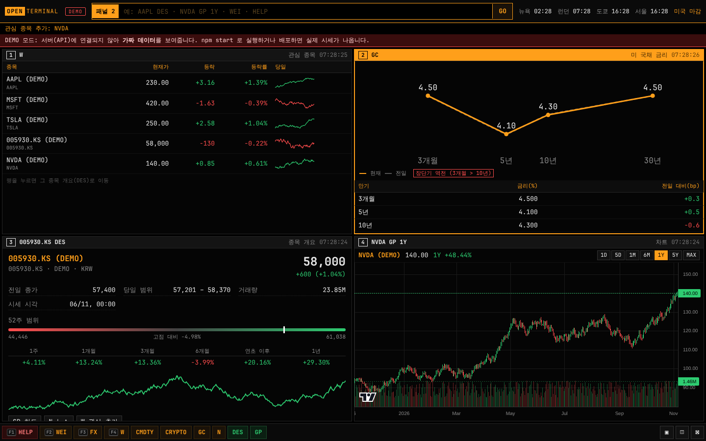

# OPEN TERMINAL

블룸버그 단말기처럼 **명령줄로 움직이는 4분할 시장 단말기**. 빌드 도구 없이 HTML·JS만으로 동작하고, 시세는 작은 서버(API)가 Yahoo Finance 공개 데이터를 받아 전달합니다.



## 1. 명령줄

맨 위 입력창에 `종목 + 기능` 을 치고 Enter. 결과는 **선택된 패널**(주황 테두리)에 열립니다.

| 입력 | 결과 |
|---|---|
| `AAPL` | 종목만 치면 개요(DES) |
| `AAPL DES` | 종목 개요: 가격·등락·당일 범위·52주 범위·기간 수익률 |
| `NVDA GP` · `NVDA GP 주봉` | 캔들 차트: `5분 15분 60분 일봉 주봉 월봉` (영문 `D W M 1H`도 가능), 이동평균 5·20·60·120, 거래량, 시·고·저·종 표시. 색은 한국식(빨강 상승·파랑 하락) 기본, 차트의 버튼으로 미국식 전환 |
| `TSLA N` / `N` | 종목 뉴스 / 시장 뉴스 |
| `WEI` | 세계 주요 지수 (코스피·코스닥 포함) |
| `FX` · `CMDTY` · `CRYPTO` | 환율 · 원자재 · 암호화폐 |
| `GC` | 미 국채 금리 곡선 (3개월·5년·10년·30년, 장단기 역전 표시) |
| `W` · `W ADD NVDA` · `W DEL NVDA` | 관심 종목 (브라우저에 저장) |
| `LAYOUT 1` / `2` / `4` | 화면 분할 수 |
| `HELP` | 명령어 목록 |

- 블룸버그 문법도 인식: `AAPL US Equity GP <GO>`, `005930 KS DES` (KS 코스피 · KQ 코스닥 · JP 일본 · LN 런던 · HK 홍콩)
- 6자리 숫자만 치면 코스피 종목으로 처리: `005930` → `005930.KS`
- 입력하는 동안 종목 검색·기능 자동완성 (`Tab` 또는 `↑↓` + `Enter`)
- 단축키: `/` 명령줄 · `Esc` 지우기 · `↑↓` 이전 명령 · `Alt+1~4` 패널 선택 · `F1` HELP · `F2` WEI · `F3` FX · `F4` W

## 2. 멀티 패널

- 4분할(기본) · 2분할 · 1분할. 패널마다 다른 기능을 띄우고 각자 30~120초마다 자동 갱신(깜빡임 없이 교체).
- 표의 행을 누르면 그 종목 개요로, 개요의 버튼으로 차트·뉴스·관심 추가로 이동.
- 패널 구성·분할·명령 기록은 브라우저에 저장되어 새로고침해도 유지.
- 휴대폰에서는 패널이 세로로 쌓이고, 명령줄은 위·기능키는 아래에 고정.

## 실행

```bash
npm start          # http://localhost:8787  (Node 20+, 설치할 패키지 없음)
npm test           # 명령어 해석 + API 단위 테스트
```

서버 없이 `public/index.html`만 열면 **DEMO 모드**(빨간 배너)로 가짜 데이터를 보여줍니다.

## 배포 (Cloudflare Workers — 무료)

`wrangler.toml` + `worker.mjs` 가 들어 있어 Worker 하나가 화면(`public/`)과 시세 API(`/api/*`)를 같은 주소로 서비스합니다. 키·비밀값 필요 없음.

1. Cloudflare 가입 → **Workers & Pages → Create → Import a repository** → GitHub 연결 → `investment` 선택
2. 설정: Project name `open-terminal` · Build command **비움** · Deploy command `npx wrangler deploy` · 배포할 브랜치 선택
3. 배포가 끝나면 `https://open-terminal.<계정>.workers.dev` 주소가 생김 → 상단 배지가 **LIVE** 면 야후 시세 연결 성공

터미널로 배포하려면: `npx wrangler login` → `npm run deploy`. 로컬 확인: `npm run dev:cf`.

Netlify(`netlify.toml`)로도 배포할 수 있습니다.

## 구조

```
public/index.html          화면 골격 (상단 명령줄 · 패널 그리드 · 하단 기능키)
public/js/commands.js      명령어 해석기 (순수 함수, 테스트 대상)
public/js/app.js           패널·레이아웃·자동완성·단축키·시계
public/js/functions.js     기능별 화면 (DES GP N WEI FX CMDTY CRYPTO GC W HELP)
public/js/api.js           데이터 호출 + DEMO 대체 데이터
public/vendor/             TradingView Lightweight Charts 4.2.3 (Apache-2.0)
api/yahoo.mjs              /api/health · chart · quotes · search (로컬·Cloudflare·Netlify 공용)
worker.mjs                 Cloudflare Worker 진입점
server.mjs                 로컬 서버 (정적 파일 + API)
```

## 한계 (정직하게)

- 시세는 Yahoo Finance 비공식 공개 엔드포인트라 **지연 시세**이고, 예고 없이 막힐 수 있습니다. 상업적 사용 불가.
- 로그인 쿠키가 필요한 항목(시가총액·PER·기업 설명)은 아직 없음. DES는 가격 기반 지표만 표시합니다.
- 투자 자문이 아닙니다.
